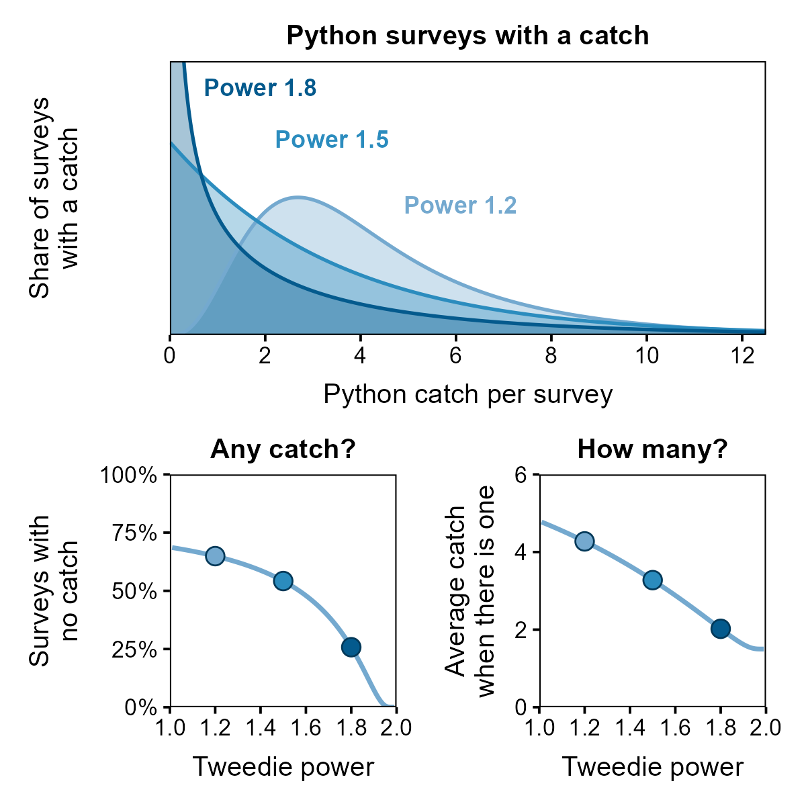

# Tuning the loss function along with the network

Most survey data are mostly zeros. Most surveys catch nothing, and the ones that do catch something vary a lot in how much. Two loss functions suit that kind of response, and both have settings that usually stay at their defaults. Here those settings are treated as hyperparameters, so the tuner searches them together with the network.



A Tweedie response answers two questions about a survey in one distribution. Did it catch anything, and how much did it catch when it did? The power sets the balance between the two. All three curves above have the same average catch.

## What is here

`tune_loss_functions.R` simulates 4,000 surveys from a Tweedie distribution with a known power, then runs two short searches with Keras Tuner.

- Any catch? A classifier trained with binary focal cross-entropy. The search covers the loss's class weight (alpha) and focusing parameter (gamma) along with the layer width and learning rate.
- How much? A regression network trained with a Tweedie loss. The search covers the Tweedie power between 1.01 and 1.99 along with the layer width and learning rate.

Each search scores its trials on a validation metric that does not depend on the loss (AUC for the classifier, root mean squared error for the regression). Loss values under different settings are on different scales, so the loss itself can't be used to compare trials.

`tweedie_power_figure.R` draws the figure above from the Tweedie distribution directly. Nothing in it is fitted.

## Running it

From the repository root

```bash
Rscript tuned-loss-functions/tune_loss_functions.R
```

```bash
Rscript tuned-loss-functions/tweedie_power_figure.R
```

The tuning script needs the `keras3` package. The first run downloads TensorFlow and Keras Tuner into a private Python environment, which takes a few minutes. After that the script takes about two minutes on a laptop without a GPU. The figure script needs `dplyr`, `ggplot2`, `patchwork` and `ragg`.

## What to expect

The script prints the five best trials of each search and the scores of the two best networks on test surveys the search never saw. Each search runs only 12 trials so that it finishes quickly, which means the winning settings move around from seed to seed. The best power will not always land on the 1.3 the surveys were simulated at. A real search needs far more trials.

## Where this comes from

The approach is from our paper predicting Burmese python survey outcomes, where the same two losses were tuned over 1,000 trials per network inside a custom training loop.

Romer, A. S., et al. 2026. Prioritizing removals of a highly cryptic invasive species using machine learning and demographic weighting. *Ecological Applications*. <https://doi.org/10.1002/eap.70317>

The full analysis code is in the paper's repository at release v1.0.2, in [`R/02_PEP_Demo_MachineLearning.R`](https://github.com/Asromer-biology/Romer_et_al_2026_python_prioritization/blob/v1.0.2/R/02_PEP_Demo_MachineLearning.R).
